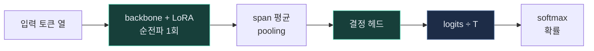
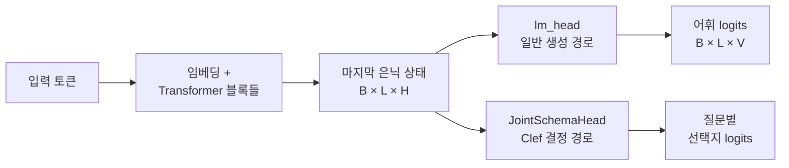
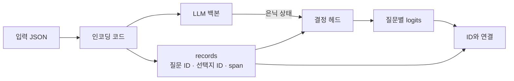
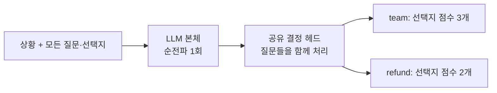
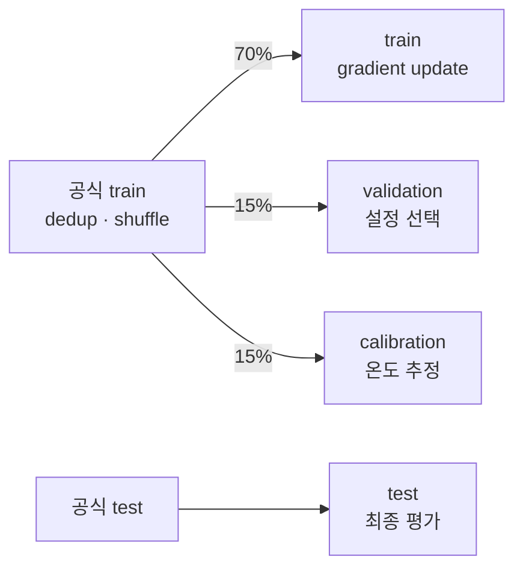
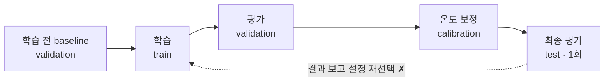
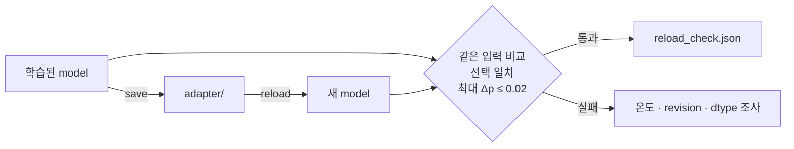
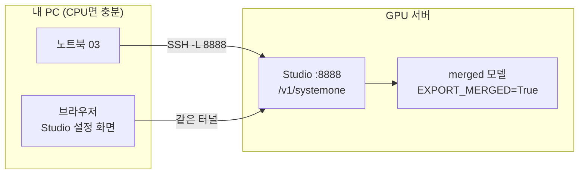

<div class="eyebrow">DECISION MODELS · GPU WORKSHOP</div>

# 문장을 생성하는 대신<br>결정을 학습한다

<div class="subtitle">Jev · Laya · Clef · Unsloth</div>

상태와 질문을 입력하고, 선택지의 확률을 얻는 모델

<div class="callout mt-8">문의마다 담당 팀을 골라야 하고, 그 판단을 <b>얼마나 믿을 수 있는지</b>도 알아야 한다면?</div>

<div class="cover-foot">딥러닝 경험자 · NVIDIA GPU 서버 · 110분<br>2026.10.13 · 개념 / 학습 / 보정 / 서빙</div>

<!--
오프닝 2분. 화면의 질문으로 시작한다. “이 문의는 billing”이라는 답만으로는 자동 처리할지 사람에게 넘길지 정할 수 없다. 그래서 확률과 그 확률의 신뢰도가 오늘의 주제다.
Jev와 호환 API, 공개 모델의 구분을 첫 장부터 명확히 한다.
-->

---

# 노트북 세 개로 결과물을 만든다

<div class="grid grid-cols-3 gap-5 mt-8">
<div class="card"><span class="num">01</span><h3>확률을 읽는다</h3><p>정확도 · NLL · Brier · ECE<br>보정 온도와 보류(사람 검토) 임계값</p><code>01_probabilities…ipynb</code></div>
<div class="card"><span class="num">02</span><h3>모델을 학습한다</h3><p>Qwen + 결정 헤드 + LoRA<br>보정 · 저장 · 재로딩</p><code>02_train…ipynb</code></div>
<div class="card"><span class="num">03</span><h3>API를 검증한다</h3><p>응답 형식 규칙(계약)<br>정확도 · 지연시간 · 보류</p><code>03_test…ipynb</code></div>
</div>

<div class="callout">완료 기준: 정답을 고르는 것과 그 확률을 믿을 수 있는 것을 <b>따로 측정</b>한다.</div>

<div class="legend"><span><span class="sw key"></span>핵심</span><span><span class="sw warn"></span>주의 · 하지 말 것</span></div>

<!--
1분. 색 규칙을 한 번 소개한다. 이후 모든 장에서 같은 의미로 쓴다. 노트북은 output/jupyter-notebook 아래에 있다. 01/03은 표준 라이브러리만 사용한다.
02는 NVIDIA GPU가 필요하다. GPU가 없는 강의자는 실행 결과를 미리 준비한다.
-->

---

# 끝나면 네 가지를 할 수 있다

| # | 학습 목표 | 확인 방법 |
|---|---|---|
| 1 | 결정 모델의 입력(질문·선택지 정의)과 타입별 출력을 **해석**하고 생성형 LLM과 구분한다 | 마무리 Q1 |
| 2 | 정답률과 확률 품질을 따로 **측정**하고 온도·임계값을 선택한다 | 노트북 01 · Q2, Q3 |
| 3 | 누수 없는 분할로 결정 모델을 학습·보정하고 재로딩을 **검증**한다 | 노트북 02 · Q5 |
| 4 | 로컬 API를 응답 형식·연결·품질로 **나눠 테스트**한다 | 노트북 03 · Q4 |

<div class="callout">각 목표는 마무리 질문과 노트북 산출물로 확인한다.</div>

<!--
1분. 목표를 소리 내어 읽고, 각 목표가 어느 실습에서 확인되는지 짚는다.
마무리 질문 슬라이드에서 이 표를 다시 참조한다.
-->

---

# 시작 전 예측: 세 문항

1. 모델이 확률 **0.9**로 답한 사례들의 실제 정답률은 90%일까?
2. 학습 전 정확도가 낮다면 Qwen 본체가 약하다는 뜻일까?
3. 학습이 끝난 뒤 확률을 조정하는 **보정 온도**를 바꾸면 **accuracy**도 바뀔까? <span class="stat-label">(생성 샘플링 온도와 다른 개념)</span>

<div class="callout">답은 적어 두기만 한다. 마무리에서 같은 문항에 다시 답하고 바뀐 답을 비교한다.</div>

<!--
2분. 손들기나 투표 도구로 응답 분포를 기록한다. 정답은 아직 말하지 않는다.
답: (1) 보장되지 않는다. calibration으로 검증할 성질이다. (2) 아니다. 새 결정 헤드가 무작위 초기화 상태다.
(3) 아니다. 양의 스칼라 T는 argmax를 유지한다. 사전·사후 정답률 변화를 강의 개선에 사용한다.
-->

---

# 질문 하나씩 답하며 110분을 진행한다

| 시간 | 주제 | 0 ─ 110분 | 확인할 질문 |
|---|---|---|---|
| 0–21분 | Jev와 질문 스키마 | <div class="gbar"><i style="left:0%;width:19.1%"></i></div> | 무엇을 출력하는가? |
| 21–35분 | 구조와 손실 | <div class="gbar"><i style="left:19.1%;width:12.7%"></i></div> | 무엇을 학습하는가? |
| 35–50분 | 확률·평가 실습 | <div class="gbar"><i class="lab" style="left:31.8%;width:13.6%"></i></div> | 확률을 믿어도 되는가? |
| 50–76분 | GPU 학습 실습 | <div class="gbar"><i class="lab" style="left:45.5%;width:23.6%"></i></div> | 데이터가 새지 않았는가? |
| 76–91분 | 저장·서빙·API 테스트 | <div class="gbar"><i class="lab" style="left:69.1%;width:13.6%"></i></div> | 같은 모델이 연결되었는가? |
| 91–99분 | 실험 설계와 마무리 | <div class="gbar"><i style="left:82.7%;width:7.3%"></i></div> | 결과가 어디까지 유효한가? |
| 99–110분 | 질의응답 · 여유 | <div class="gbar"><i style="left:90%;width:10%"></i></div> | |

<div class="legend"><span><span class="sw concept"></span>개념</span><span><span class="sw key"></span>실습</span><span>GPU 실습에는 <b>학습 대기 8분</b>(실측 전 계획값)이 들어 있고, 대기 중 수치 해석 두 장을 진행한다.</span></div>

<div class="caption">구조 설명 뒤 심화 Q&amp;A 14장은 선택 자료다. 모두 설명하면 기본 110분 외에 약 16분을 추가한다.</div>

<!--
1분. 60-step 학습이 시간 내 완료되지 않을 때는 서버를 실행해 두고 평가 설명으로 이동한다.
실측 결과가 없는 상황에서 예상 정확도를 대신 보여주지 않는다.
첫 GPU 리허설에서 smoke 학습 시간과 peak VRAM을 측정해 이 표를 갱신한다. 학습이 8분보다 길면 질의응답·여유 11분에서 가져온다.
-->

---
layout: section
---

<div class="eyebrow">PART 01 · INTERFACE</div>

# 결정 모델은 무엇을 입력받고 무엇을 내놓는가?

상태 + 질문 스키마 → 선택지 확률

<!--
전환: “오늘 만들 것과 순서를 봤으니, 먼저 이 모델이 무엇을 받고 무엇을 돌려주는지부터 봅시다. 출력 형식을 알아야 뒤에서 그 확률을 믿을 수 있는지 따질 수 있습니다.”
-->

---

# 질문은 유연하게, 응답은 확률로

| 접근 | 답을 얻는 방법 | 비용과 제약 |
|---|---|---|
| LLM | 문장·JSON을 생성한 뒤 파싱 | 토큰 생성 시간 · 형식 오류 처리<br>선택지 확률은 별도 설계 필요 |
| BERT 분류기 | 작업별로 정해진 라벨을 분류 | 출력 라벨이 바뀌면 헤드 수정·재학습 필요 |
| **Jev** | 요청마다 질문·선택지를 정의<br>**선택값과 확률을 구조화해 반환** | 새 질문·선택지도 입력으로 전달<br>실제 성능과 확률 보정은 검증 필요 |

<div class="callout"><b>Jev의 선택:</b> 질문·선택지를 입력으로 받는 유연성과<br>소프트웨어가 바로 사용할 수 있는 확률 출력을 결합한다.</div>

<div class="source">참고: <a href="https://discuss.pytorch.kr/t/jev-system-one-feat-typesafe-ai/11935">PyTorch 한국 사용자 모임 · Jev와 System One 소개</a></div>

<!--
1분. 채팅 LLM은 생성 후 파싱하고, 전통적인 고정 라벨 분류기는 학습한 라벨에 맞춘 출력 헤드를 사용한다. Jev는 질문과 선택지를 요청 입력에 포함해 구조화된 결정과 확률을 반환한다.
BERT 계열 전체가 질문을 바꾸면 반드시 재학습해야 한다는 뜻은 아니다. 여기서는 작업별 고정 라벨 분류기를 비교한다. 같은 라벨을 유지한 표현 변경만으로 재학습이 항상 필요한 것은 아니다.
구조화 출력이나 제약 디코딩으로 생성형 LLM의 형식 오류를 줄일 수 있다. Jev 응답도 확률만 있는 것은 아니며, 타입에 따라 선택값·점수·confidence 등이 포함된다.
-->

---
layout: two-cols
---

# 생성은 문장, 결정은 분포

### 생성형 LLM

```text
입력: 고객이 중복 결제를 문의함
출력: "billing 팀으로 보내세요."
```

- 문자열 또는 JSON 생성
- 생성 토큰과 형식 처리 필요
- 선택지 확률은 별도 설계 필요

::right::

<div class="mt-16"></div>

### 결정 모델

```json
{
  "billing": 0.80,
  "technical": 0.15,
  "sales": 0.05
}
```

- 입력: 상태 + 질문 “담당 팀은?” + 선택지 3개
- **확률을 직접 후속 정책에 사용**

<!--
2분. 왼쪽은 문장을 만들고 나서 해석해야 하고, 오른쪽은 처음부터 선택지별 확률이 나온다는 차이만 짚는다.
“그럼 LLM logprob로 분류하면 되지 않나?”라는 질문은 다음 장에서 받는다.
-->

---

# logprob 분류와 무엇이 다르고, 언제 쓰지 않는가

| 방식 | 선택지 확률을 얻는 법 | 주의할 점 |
|---|---|---|
| 생성 + 파싱 | 따로 없음 | 형식 오류 처리, 확률은 별도 설계 |
| LLM logprob | 선택지 토큰의 확률로 근사 | 선택지가 여러 토큰이면 선택지마다 채점, 과제에 맞춘 보정 없음 |
| 결정 모델 | 선택지 전체 분포를 직접 출력 | 헤드 학습과 보정이 필요 |

<div class="grid grid-cols-2 gap-5 mt-4">
<div class="card"><h3>쓰기 좋은 곳</h3><p>선택지가 정해진 분류 · 라우팅 · 가드레일<br>확률로 자동 처리 범위를 정할 때 · 대량 요청</p></div>
<div class="card"><h3>쓰지 않는 곳</h3><p>자유 서술 답변 · 설명 자체가 결과물일 때<br>선택지를 미리 정할 수 없는 과제</p></div>
</div>

<!--
2분. 결정 모델이 모든 업무에서 더 낫다고 주장하지 않는다.
logprob 방식도 실제로 쓰인다. 차이는 여러 토큰짜리 선택지를 다루는 방법, 한 번에 여러 질문을 처리하는지, 확률을 과제에 맞춰 보정하는지다.
-->

---

# Jev는 개념의 출발점, 학습 대상은 공개 모델

**System One**: Kahneman의 빠른 직관적 사고(System 1)에서 따온 이름. 자유 생성 대신 구조화된 결정을 빠르게 내는 모델 계열이다.

| 구분 | 역할 | 이 강의에서의 사용 |
|---|---|---|
| **Jev** | TypeSafe의 System One API 모델 (구조·가중치 비공개) | 따라 할 API 형식의 기준 |
| **Laya** | 인코더 기반 공개 결정 모델 | CPU 로컬 API 테스트 경로 |
| **Clef** | LLM 본체 + 결정 헤드의 공개 모델 | 구조적 참고 |
| **Unsloth 변환 모델** | 공개 LLM에 결정 헤드를 붙여 학습 | Qwen + LoRA 실습 |

<div class="callout warn">API 형식이 같아도 <b>가중치·확률 보정·정확도·지연시간은 다르다.</b> 로컬 Studio의 <code>jev-latest</code>는 <b>Settings에서 고른 모델의 별칭</b>이며 TypeSafe를 호출하지 않는다.</div>

<div class="source">출처: <a href="https://typesafe.ai/blog/introducing-system-one-models-and-jev">TypeSafe 소개</a> · <a href="https://unsloth.ai/docs/models/decision-laya">Unsloth 로컬 서빙</a></div>

<!--
2분. Jev 자체의 비공개 가중치를 재학습하는 실습이 아니다.
로컬 API에서 jev-latest라는 별칭을 써도 TypeSafe 서버를 호출하는 것은 아니다.
-->

---

# 요청은 State + Questions, 응답은 타입별 확률

**State**: 판단할 텍스트·JSON ┃ **Questions**: 그 상태에 대해 답할 항목들

| 유형 | 용도 | 돌려받는 값 |
|---|---|---|
| `noul` | 예 / 아니오 | “예”일 확률 · 0~1 |
| `choice` | 여러 선택지 중 하나 고르기 | 가장 유력한 선택지 + 선택지별 확률 |
| `score` | 순서가 있는 등급 매기기 | 등급별 확률 + 기대 점수 · 등급 번호는 0부터 |

<div class="callout" style="margin-top:16px;padding:10px 20px"><b>choice·score의 confidence</b>: 1에 가까우면 한 답이 두드러지고,<br>0에 가까우면 확률이 고르게 퍼진다. 실제 정답률을 뜻하지 않는다.</div>

<div class="callout warn" style="margin-top:16px;padding:10px 20px"><b>실제 동작은 선택지별 probabilities로 결정한다.</b><br>예: <code>probabilities["technical"] &gt; 0.8</code>일 때만 버그 리포트 생성</div>

<div class="source">Unsloth Decision API 문서 기준: 요청당 <b>64개 질문</b> · choice당 <b>255개 선택지</b> · score당 <b>10개 등급</b><br><a href="https://unsloth.ai/docs/models/decision-laya">출처: Unsloth · Laya & Decision Models</a></div>

<!--
1분. state는 판단 대상이고 questions는 판단할 항목의 묶음이다. model 같은 호출 설정도 요청에 포함되지만, 판단 내용의 핵심은 이 두 부분이다.
confidence는 분포가 얼마나 집중되는지 나타내며 선택지 확률이나 실제 정답률과 같다고 가정하지 않는다. Jev와 Laya는 계산식이 다르므로 confidence 임계값을 그대로 옮기지 않는다.
0.8은 정책 설명용 임계값이다. 실제 운영 임계값은 검증 데이터와 오판 비용을 바탕으로 정한다. 개수 제한은 Unsloth 서빙 문서 기준이며 선택지 설명의 토큰 예산도 고려한다.
-->

---

# 하나의 상태에 여러 질문을 함께 묻는다

```python {1|3-6|7|8-11|all}
state = "어제 두 번 결제됐어요. 오늘 중복 금액을 환불해 주세요."
questions = {
    "team": {
        "type": "choice", "instructions": "담당 팀은?",
        "criteria": {"billing": "결제·환불", "technical": "오류", "sales": "견적"}
    },
    "refund": {"type": "noul", "instructions": "환불을 요청하는가?"},
    "urgency": {
        "type": "score", "instructions": "처리 긴급도는?",
        "criteria": ["일반", "곧 처리", "오늘 처리"]
    }
}
```

`noul` 예/아니오 · criteria 없음 ┃ `choice` 하나 고르기 · `{키: 설명}` ┃ `score` 순서 등급 · 낮은 것부터 목록(번호 0, 1, 2)

**질문·선택지 설명도 모델 입력이다.** `state`는 문자열 또는 JSON.

<!--
2분. 클릭마다 choice → noul → score 질문을 하나씩 짚는다. 세 질문을 각각 호출할 수도 있지만 한 상태의 다중 질문이 기본 패턴이다.
API는 gold를 받지 않는다. 학습 데이터에서만 gold가 존재한다.
-->

---

# 응답은 질문 키마다 타입별 필드를 돌려준다

```json {3-4|5|6-8|all}
{
  "answers": {
    "team":    { "type": "choice", "choice": "billing", "confidence": 0.80,
                 "probabilities": { "billing": 0.80, "technical": 0.15, "sales": 0.05 } },
    "refund":  { "type": "noul", "noul": 0.90 },
    "urgency": { "type": "score", "score": 1.6, "confidence": 0.70,
                 "legend": { "0": "일반", "1": "곧 처리", "2": "오늘 처리" },
                 "probabilities": { "0": 0.1, "1": 0.2, "2": 0.7 } }
  }
}
```

- 질문 키가 그대로 응답 키다. `"choice": "billing"`은 **고른 선택지**이며 `type` 이름과 같을 뿐이다.
- **`confidence`는 확률 분포의 집중도를 나타내는 값**이며 계산은 모델마다 다르다. `legend`는 등급 번호의 이름표다.

<!--
2분. 앞 장의 요청과 이 응답을 한 줄씩 대응시킨다.
임계값은 confidence보다 probabilities에 건다(서빙 문서 권고). confidence는 모델마다 계산이 다를 수 있기 때문이다.
응답 최상위에는 model과 usage(input_tokens, output_tokens)도 붙는다. 03의 validate_answers는 answers의 핵심 필드만 검사한다.
-->

---

# 세 타입의 의미를 구분하자

| 타입 | 응답 핵심 | 해석 | 흔한 실수 |
|---|---|---|---|
| `noul` (예/아니오) | `noul: 0.8` | yes 확률 80% | boolean으로 간주 |
| `choice` | 선택 키 + 확률 분포 | 가장 높은 선택지 | confidence를 정답률로 해석 |
| `score` | 등급 확률 + 기대 점수 | 등급 번호의 기댓값 | argmax 등급과 혼동 |

$$
\text{score}=\sum_{k=0}^{K-1} k\,p_k
$$

<div class="flex items-end gap-12 mt-2">
<div><div class="big-num">1.6</div><div class="stat-label">기대 점수 score</div></div>
<div><div class="big-num muted">2</div><div class="stat-label">확률이 가장 높은 등급 argmax</div></div>
<div class="stat-label pb-1">등급 <code>[0, 1, 2]</code>의 확률이 <code>[0.1, 0.2, 0.7]</code>일 때<br><b>score</b> = 0 × 0.1 + 1 × 0.2 + 2 × 0.7 = <b>1.6</b><br><b>score</b>는 등급에 확률을 곱해 더한 평균,<br><b>argmax</b>는 확률이 가장 높은 등급이다.</div>
</div>

<!--
2분. 노트북 01 §2에서 같은 계산을 확인할 수 있다. noul은 yes/no 질문 타입이며 응답값은 yes일 확률이다.
score는 연속값처럼 보이지만 원래 순서 있는 등급 위의 분포다.
척도의 간격을 수치화하는 가정이 정책에 적절한지도 검토한다.
-->

---

# 확률과 confidence는 같은 말이 아니다

<div class="grid grid-cols-2 gap-8 mt-2 items-center">
<div>
<div class="card mb-4"><h3>모델 출력</h3><p>고른 답의 확률(confidence) 0.9는 정답률 90%를 <b>보장하지 않는다.</b></p></div>
<div class="card"><h3>검증할 성질</h3><p>0.9로 예측한 사례 중 실제로 약 90%가 정답인가? 이 관계가 <b>calibration(보정)</b>이다.</p></div>
</div>
<div>
<svg class="chart" viewBox="0 0 300 258" width="300" role="img" aria-label="reliability diagram">
<rect x="50" y="20" width="200" height="200" fill="#16233a" stroke="#34445b"/>
<line x1="50" y1="220" x2="250" y2="20" stroke="#8b97a8" stroke-dasharray="5 4"/>
<text x="92" y="166" fill="#8b97a8" style="font-size:14px" transform="rotate(-45 92 166)">완벽한 보정</text>
<line x1="230" y1="70" x2="196" y2="70" stroke="#65e0bf" stroke-width="2"/>
<path d="M196 70 l8 -5 v10 z" fill="#65e0bf"/>
<circle cx="240.5" cy="70" r="7" fill="#f5a35c"/>
<circle cx="185.8" cy="70" r="7" fill="#65e0bf"/>
<text x="240" y="52" fill="#f5a35c" style="font-size:15px" text-anchor="middle">보정 전 0.95</text>
<text x="186" y="96" fill="#65e0bf" style="font-size:15px" text-anchor="middle">보정 후 0.68</text>
<g fill="#a3b3c9" style="font-size:14px"><text x="50" y="236" text-anchor="middle">0</text><text x="150" y="236" text-anchor="middle">0.5</text><text x="250" y="236" text-anchor="middle">1</text><text x="42" y="224" text-anchor="end">0</text><text x="42" y="124" text-anchor="end">0.5</text><text x="42" y="24" text-anchor="end">1</text></g>
<text x="150" y="254" fill="#c9d2de" style="font-size:15px" text-anchor="middle">평균 확신도</text>
<text x="14" y="120" fill="#c9d2de" style="font-size:15px" text-anchor="middle" transform="rotate(-90 14 120)">실제 정답률</text>
</svg>
</div>
</div>

모델을 바꿀 때 임계값도 validation에서 **다시 선택**한다.

<div class="source">서빙 문서: Laya와 Jev는 confidence 계산이 달라 Jev의 임계값을 재사용하지 말고, choice는 probabilities에 임계값을 건다. <a href="https://unsloth.ai/docs/models/decision-laya">문서</a></div>

<!--
2분. 여기서는 “확신과 정답률은 다르다”는 문제 제기까지만 한다. 지표(ECE)와 보정 방법은 Part 3에서 다룬다. certainty와 correctness 구분. confidence를 0.8 이상이면 환불 같은 자동 작업에 바로 연결하지 않는다.
이 강의의 라우팅은 출력만 하며 실제 외부 작업을 수행하지 않는다.
이후 슬라이드에서 calibration과 보정은 같은 뜻으로 쓴다.
그림: 대각선에 가까울수록 확신도와 정답률이 일치한다. 온도 보정은 정답률(세로)을 바꾸지 않고 확신도(가로)만 옮긴다. 값은 01의 온도 보정 셀 결과다.
-->

---
layout: section
---

<div class="eyebrow">PART 02 · MODEL</div>

# 어떤 파라미터가 결정을 배우는가?

공개 LLM 본체 + 질문을 읽는 결정 헤드

<!--
전환: “출력이 선택지별 확률이라는 걸 봤습니다. 그럼 이 확률은 어떤 구조가 만들고, 그중 어디를 우리가 학습시키는지 봅시다.”
-->

---
zoom: 0.88
---

# LLM은 한 번 읽고, 결정 헤드는 함께 채점한다

**하나의 프롬프트** = State + 모든 질문·선택지

| 단계 | Unsloth의 Clef식 결정 모델이 하는 일 |
|---|---|
| **LLM 본체** | 순전파 1회로 마지막 층의 은닉 상태를 계산 |
| **결정 헤드** | 질문·선택지 구간의 표현을 읽어 모든 질문을 함께 처리하고 채점 |
| **확률 출력** | 다음 토큰을 생성하지 않고 선택지별 확률을 반환 |

<div class="callout" style="margin-top:16px;padding:10px 20px"><b>텍스트 decoding 없음:</b> 서빙 예시의 <code>output_tokens: 0</code><br>어휘 전체의 다음 토큰 logits 계산을 생략하지만, 입력 처리·은닉 상태 메모리는 필요하다.</div>

<div class="grid grid-cols-2 gap-5 mt-4">
<div class="card" style="padding:14px 20px"><h3>새 헤드의 기본 구성</h3><p>라우팅 2층 + 디코더 4층<br>본체 은닉 차원 ≥ 3072: 폭 1024 · 16 heads<br>본체 은닉 차원 &lt; 3072: 폭 512 · 8 heads</p></div>
<div class="card" style="padding:14px 20px"><h3>학습·저장</h3><p>일반 LLM에 결정 헤드를 새로 초기화<br>본체 LoRA + 헤드를 함께 학습<br>헤드 학습률 기본값: <code>1e-4</code></p></div>
</div>

<div class="source" style="font-size:14px;margin-top:12px">출처: <a href="https://unsloth.ai/docs/new/train-your-own-decision-model-with-unsloth">Unsloth 학습 가이드</a> · <a href="https://github.com/unslothai/unsloth/blob/1e7d78415b93e4b9a036f07fdb953de11363e2dd/unsloth/models/decision_from_lm.py">decision_from_lm.py (고정 커밋)</a> · <a href="https://unsloth.ai/docs/models/decision-laya">서빙 예시</a></div>

<!--
1분. 이 장은 Unsloth의 Clef식 구현 요약이며 비공개 Jev의 내부 구조를 설명하는 것은 아니다. 마지막 은닉 상태는 마지막 토큰 하나가 아니라 본체 마지막 층의 토큰별 출력이다. 질문·선택지 구간은 평균 pooling으로 요약하고 마지막 토큰도 전역 표현으로 사용한다.
decision_from_lm.py의 default_head_config는 width를 본체 hidden_size에 따라 1024 또는 512로 고르고 heads = width // 64로 계산한다. 라우팅 층은 2, 디코더 층은 4다. 따라서 소형 모델은 8 heads다.
새 헤드는 무작위 초기화되며 ClefDecisionModel로 감싸 Clef식 학습·평가·저장 경로를 사용한다. 헤드 학습률 1e-4는 DecisionTrainer 기본값이고 LoRA 학습률과 분리한다.
토큰 생성이나 어휘 전체 logits 계산을 하지 않는다는 것과 모델의 어휘 임베딩 가중치를 메모리에서 모두 없앤다는 것은 다르다. 입력 인코딩과 결정 헤드 계산 비용은 남는다. output_tokens: 0은 Unsloth 서빙 예시이며 모든 제공자의 usage 규칙을 뜻하지 않는다.
-->

---

# 한 번의 본체 순전파로 여러 질문에 답한다



<div class="legend"><span><span class="sw key"></span>학습: LoRA · 헤드</span><span><span class="sw concept"></span>보정 단계에서 결정: 온도 T</span><span>나머지 본체 가중치는 고정</span></div>

<v-clicks>

- 입력은 state·질문·선택지를 이은 **하나의 토큰 열**이다. 모든 질문이 같은 순전파를 공유한다.
- 질문·선택지마다 **토큰 구간(span)의 평균**을 내고, 마지막 토큰은 입력 전체를 요약한 전역 벡터로 쓴다.
- 헤드는 질문들을 **한 번에 함께 처리**(attention)하고, 질문 벡터와 각 선택지 벡터의 **유사도**로 선택지 점수를 낸다. 처음 보는 선택지도 채점할 수 있는 이유다.
- 문장 decoding은 없지만 긴 입력을 읽는 비용은 남는다(`output_tokens=0` ≠ 비용 0).

</v-clicks>

<div class="source">Unsloth의 Clef식 구조이며 Jev 내부 구조는 추정하지 않는다. 구현: <a href="https://github.com/unslothai/unsloth/blob/1e7d78415b93e4b9a036f07fdb953de11363e2dd/unsloth/models/decision_from_lm.py">decision_from_lm.py</a> · <a href="https://github.com/unslothai/unsloth/blob/1e7d78415b93e4b9a036f07fdb953de11363e2dd/unsloth/models/clef.py">clef.py</a> (batched_logits)</div>

<!--
4분. 왼쪽에서 오른쪽으로 따라가며 각 단계에서 무엇이 학습되는지 묻는다(본체 LoRA, 헤드 전체, 온도는 보정 단계).
pooling: 질문 설명과 각 선택지 설명의 토큰 구간 평균, 그리고 마지막 토큰 벡터를 전역 벡터로 쓴다.
헤드의 질문 필드는 TransformerDecoder로 함께 처리되어 서로와 전체 토큰을 참조한다.
선택지 점수(batched_logits): 선택지 단어 임베딩과 질문의 사전 유사도 + 게이트 × (질문 필드와 선택지 벡터의 cosine 유사도 + 잔차 점수).
스키마를 입력으로 받으므로 고정 label classifier와 다르다. 다만 처음 보는 선택지를 채점할 수 있다는 것과 맞힌다는 것은 별개다. 일반화는 따로 검증한다.
-->

---
zoom: 0.88
---

<div class="eyebrow">심화 Q&A · 01 / 14 · 선택 설명</div>

# LLM → 결정 모델: 구조를 붙이고 판단을 학습한다

| 단계 | 코드·동작 | 이때의 의미 |
|---|---|---|
| 1. 본체 로딩 | 사전학습된 Qwen 등의 가중치 로딩 | 언어·문맥 표현을 재사용 |
| 2. 헤드 추가 | `JointSchemaHead(**config)` | 새 헤드는 무작위 초기화 |
| 3. 모델 연결 | `ClefDecisionModel(backbone, head)` | 본체 표현 → 선택지 점수 |
| 4. 학습 | `get_peft_model` → `DecisionTrainer.train()` | 정답으로 LoRA와 헤드를 조정 |
| 5. 저장 | `model.save_pretrained(...)` | 학습한 LoRA·헤드를 보관 |

<div class="callout"><b>헤드를 붙인 직후 ≠ 판단 학습 완료.</b><br>상황·질문·선택지와 정답을 함께 제공해야 채점 능력을 배운다.</div>

<div class="source">소스: <a href="https://github.com/unslothai/unsloth/blob/1e7d78415b93e4b9a036f07fdb953de11363e2dd/unsloth/models/decision_from_lm.py#L144-L229">load_lm_as_decision_model</a> · 실습: <code>02_train_decision_model.ipynb</code> §4·6·8</div>

<!--
선택 설명 1분. 이 세션의 Q&A를 정리한 심화 14장 시작. 기본 110분 수업에서는 필요한 질문만 골라 설명하거나 배포용으로 사용한다. 모두 설명하면 별도 시간을 확보한다.
본체는 사전학습 상태지만 새 헤드는 무작위 상태다. 기존 Clef 체크포인트를 불러오거나 head_init을 지정하는 경우에는 학습된 헤드를 불러올 수 있다.
default_head_config는 routing_layers=2, layers=4, width=1024 if hidden_size>=3072 else 512, heads=width//64다. DecisionTrainer의 HEAD_LEARNING_RATE 기본값은 1e-4.
실습은 본체 LoRA와 헤드를 함께 학습한다. 본체를 고정하고 헤드만 학습하거나 full finetuning을 하는 구성도 가능하다.
-->

---
zoom: 0.88
---

<div class="eyebrow">심화 Q&A · 02 / 14</div>

# 새 질문을 입력할 수 있다 ≠ 새 질문도 잘 맞힌다

**공유 헤드가 질문·선택지의 의미를 읽는다.** 질문마다 별도 분류기를 만들지 않는다.

| 질문의 변화 | 기대와 검증 |
|---|---|
| “담당 팀은?” → “어느 부서로 전달할까?” | 의미가 같은 표현 변화 → 일반화 가능, 평가로 확인 |
| 새 팀 설명·새 선택지 추가 | 구조 변경 없이 채점 가능 → 선택 정확도는 별도 검증 |
| 담당 팀 분류 → 긴급도 판단 | 다른 판단 기준 → 추가 학습이 필요할 수 있음 |
| 고객 문의 → 의료 판단 | 영역·지식의 변화 → 기존 성능을 그대로 기대할 수 없음 |

<div class="grid grid-cols-2 gap-5 mt-4">
<div class="card" style="padding:12px 18px"><h3>왜 일반화가 가능한가?</h3><p>본체의 사전학습 표현 + 다양한 질문으로 학습한 공유 채점 방식</p></div>
<div class="card" style="padding:12px 18px"><h3>어떻게 확인하는가?</h3><p>새 사례 평가에 더해, 질문 종류 자체를 학습에서 제외한 평가</p></div>
</div>

<!--
선택 설명 1분. 랜덤 헤드가 자동으로 범용 판단 능력을 갖는 것은 아니다. 제한된 질문만 학습하면 단어·위치 패턴을 암기할 수 있다.
질문 문구만 바꾼 것, 새 사례, 질문 종류 전체를 바꾼 것은 서로 다른 일반화 평가다. 관련 질문을 그룹으로 묶어 분할하고 테스트 결과를 보고 설정을 다시 고르지 않는다.
정책이 바뀌었다면 새 판단 기준을 instructions/state에 제공하거나 추가 학습하는 방식을 평가한다. 재학습 필요 여부는 질문 문자열의 변경 자체가 아니라 성능 요구로 결정한다.
-->

---
zoom: 0.88
---

<div class="eyebrow">심화 Q&A · 03 / 14</div>

# 마지막 은닉 상태는 lm_head의 출력이 아니다



- `L`: 입력 토큰 수 · `H`: 본체 은닉 차원 · `V`: 어휘 수 · `B`: 배치 크기
- **마지막 층의 모든 토큰 표현**을 전달한다. 마지막 토큰 하나만 쓰는 것이 아니다.
- Clef는 어휘 전체 logits를 계산하지 않지만, **출력 임베딩 가중치**는 선택지 표현에 사용한다.

<div class="source">소스: <a href="https://github.com/unslothai/unsloth/blob/1e7d78415b93e4b9a036f07fdb953de11363e2dd/unsloth/models/decision.py#L292-L333">ClefDecisionModel.forward</a></div>

<!--
선택 설명 1분. out_head라고 부른 부분이 lm_head라면 그 결과를 의미하지 않는다. text_model(...).last_hidden_state를 받는다. 본체에 따라 최종 정규화까지 거친 출력이다.
Unsloth 래퍼는 self.encoder, Cloudflare 원본 ClefModel은 self.language_model이라는 속성명으로 본체를 보관한다. 원본 릴리스 로더는 Qwen3_5ForConditionalGeneration을 사용한다.
출력 임베딩을 읽는 것은 hidden @ W_vocab^T를 계산해 어휘 전체 logits를 만드는 것과 다르다. 선택지의 토큰 ID에 해당하는 가중치 행을 읽어 평균한다.
-->

---
zoom: 0.88
---

<div class="eyebrow">심화 Q&A · 04 / 14</div>

# JointSchemaHead 안에도 Transformer가 있다

| 구성 | 입력·처리 | 역할 |
|---|---|---|
| 표현 준비 | 정규화 · span 평균 · `H → W` 투영 | 질문·선택지·전체 토큰 메모리 구성 |
| 근거 라우팅 | 선택지 query → 전체 메모리 cross-attention | 선택지마다 상황의 근거를 반영 |
| 공동 질문 디코더 | 질문 간 self-attention + 메모리 cross-attention | 여러 질문의 표현을 함께 갱신 |
| 채점 | 어휘 prior + cosine + 잔차 MLP | 질문별 선택지 logits 계산 |

<div class="callout"><b>질문별 벡터는 유지된다.</b> 함께 attention해도 질문들이 하나의 결과로 합쳐지는 것은 아니다.</div>

<div class="caption">새 헤드 기본값: 라우팅 2층 · 디코더 4층 · 폭 W=1024 또는 512.<br>여기서 “디코더”는 질문 벡터를 처리하며 답변 문장을 생성하지 않는다.</div>

<div class="source">소스: <a href="https://github.com/unslothai/unsloth/blob/1e7d78415b93e4b9a036f07fdb953de11363e2dd/unsloth/_vendor/clef/joint_schema_model.py#L242-L337">헤드 모듈 정의</a> · <a href="https://github.com/unslothai/unsloth/blob/1e7d78415b93e4b9a036f07fdb953de11363e2dd/unsloth/models/clef.py#L528-L605">계산 경로</a></div>

<!--
선택 설명 2분. W는 본체의 H와 별개인 헤드 폭이다. 저장된 릴리스는 joint_head_config.json을 읽으므로 새 헤드의 기본 설정과 다를 수 있다.
선택지 표현은 문맥 속 span 평균, 출력 임베딩에서 읽은 어휘 평균, 소속 질문 표현을 합친다. 질문 표현은 선택지 가중 요약, 마지막 토큰의 전역 표현, 질문 유형 임베딩과 결합한다.
잔차 MLP 입력은 [질문 벡터, 선택지 벡터, 원소별 곱, 차이의 절댓값]이며 4W→W→1이다. prior와 cosine에는 학습되는 scale이 있고 잔차 경로에는 gate가 있다.
-->

---
zoom: 0.88
---

<div class="eyebrow">심화 Q&A · 05 / 14</div>

# 중간 Transformer 층이 더 좋을 수도 있다

**마지막 층은 다음 토큰 예측에 적합하게 학습된다. 결정 작업의 최적 층이라는 보장은 없다.**

| 조건 | 마지막 층 사용의 의미 |
|---|---|
| 본체 고정 + 헤드 학습 | 기존 표현에서 판단 정보를 읽는 방법을 배움 |
| 본체 LoRA + 헤드 학습 | 본체 표현도 결정 손실에 맞춰 적응 가능 |

| 비교 실험 | 확인할 가설 |
|---|---|
| 마지막 층 / 중간·후반 층 하나 / 여러 층의 가중합 | 어느 표현이 판단에 더 적합한가? |

<div class="callout warn"><b>연결만 바꾸면 공정한 비교가 아니다.</b><br>각 표현에 맞춰 헤드를 다시 학습하고, 같은 분할·설정으로 평가한다.</div>

<div class="source">연구: <a href="https://arxiv.org/abs/2502.02013">Layer by Layer (2025)</a> — 텍스트 임베딩 과제에서 중간 층의 이점 보고.<br>Clef에서 중간 층이 더 좋다는 직접 비교 근거로 해석하지 않는다.</div>

<!--
선택 설명 2분. 본체 전체가 다음 토큰 예측 손실로 학습된다. 마지막 층이 생성에 특화돼도 문맥·의미 정보가 없다는 뜻은 아니다.
연구는 32개 텍스트 임베딩 과제를 다루며 Clef의 공동 스키마 채점과 동일한 실험이 아니다. Clef의 마지막 층 선택이 최적임을 이 코드만으로 입증할 수 없다.
층을 바꾸면 표현 분포와 출력 임베딩 기반 prior와의 관계가 달라질 수 있다. 헤드 재학습과 정규화·prior 경로 검토가 필요하다.
층·가중합 등 설정은 validation에서 고르고 test는 마지막에 평가한다. unseen-question 평가, NLL/ECE, 지연시간·메모리도 함께 비교한다.
-->

---
zoom: 0.88
---

<div class="eyebrow">심화 Q&A · 06 / 14</div>

# API 입력: 상황과 질문·선택지를 JSON으로 준다

<div class="grid grid-cols-[1.2fr_1fr] gap-6">
<div>

```json
{
  "model": "선택한 모델 ID",
  "state": "중복 결제됐어요. 환불해 주세요.",
  "questions": {
    "team": {
      "type": "choice",
      "instructions": "담당 팀을 선택하세요.",
      "criteria": {
        "billing": "결제 오류 및 환불",
        "technical": "서비스 장애 및 오류"
      }
    },
    "refund": {
      "type": "noul",
      "instructions": "환불 요청인가요?"
    }
  }
}
```

</div>
<div>

- `state`: 판단할 상황. 문자열 또는 JSON 값
- `team`, `refund`: 결과를 연결할 **질문 ID**
- `instructions`: 판단 기준·질문 문구
- `criteria`: 선택지 ID와 의미 설명
- `noul`: 기본 선택지는 **true / false**

<div class="callout" style="margin-top:12px">선택지의 설명도 입력이다.<br>고정된 클래스 번호만 채점하는 구조와 다르다.</div>

</div>
</div>

<!--
선택 설명 1분. 이후 예시는 이 상황과 질문 두 개를 계속 사용한다. model 필드는 사용할 모델의 식별자이며 encode_record가 이를 상황 텍스트로 넣는 것은 아니다.
choice의 criteria는 ID→설명 객체, score의 criteria는 순서 있는 설명 목록이다. noul은 내부적으로 true/false 설명을 사용하며 필요한 경우 criteria로 설명을 바꿀 수 있다.
미디어 입력을 지원하는 원본 Clef는 images/videos도 처리한다. 이 장은 텍스트 요청에 한정한다.
-->

---
zoom: 0.82
---

<div class="eyebrow">심화 Q&A · 07 / 14</div>

# 백본 입력: 질문·선택지까지 하나의 텍스트로 읽는다

<div class="grid grid-cols-[1.35fr_1fr] gap-6">
<div>

```text
<|im_start|>system
Read the complete state and schema. ...
<|im_end|>
<|im_start|>user
STATE:
중복 결제됐어요. 환불해 주세요.
SCHEMA FIELDS:
FIELD 1
ID: team
TYPE: choice
INSTRUCTION: 담당 팀을 선택하세요.
ALLOWED OPTIONS:
OPTION 1: {"option_id":"billing", ...}
OPTION 2: {"option_id":"technical", ...}
END FIELD
... refund 질문 ...
<|im_end|>
<|im_start|>assistant
<think> ... </think>
JOINT SCHEMA DECISIONS:
```

</div>
<div>

**실제 형식의 일부 생략**

- 특수 토큰을 포함해 토큰화
- 선택지에는 ID와 설명을 함께 포함
- 마지막 표식까지가 **입력**
- 이후 답변 문장을 생성하지 않고 **은닉 상태를 헤드로 전달**

<div class="caption">사용자는 JSON만 전달한다.<br>이 텍스트와 구간 정보는 인코딩 코드가 만든다.</div>

</div>
</div>

<div class="source">소스: <a href="https://github.com/unslothai/unsloth/blob/1e7d78415b93e4b9a036f07fdb953de11363e2dd/unsloth/_vendor/clef/joint_schema_model.py#L93-L183">encode_record</a></div>

<!--
선택 설명 1분. 생략 기호는 실제 프롬프트의 문자가 아니라 표시용이다. 실제 OPTION은 option_id와 description을 가진 JSON 문자열이고 키를 정렬해 직렬화한다.
SYSTEM_PROMPT는 Read the complete state and schema. Decide every field jointly. Each answer must be exactly one of that field's allowed options. 이다.
실제 assistant suffix에는 비어 있는 think 태그와 JOINT SCHEMA DECISIONS:가 들어간다. 이는 모델이 별도의 사고 과정을 생성한다는 뜻이 아니다.
choice 옵션은 ID 정렬 순서로 인코딩된다. JSON 삽입 순서를 그대로 응답 위치로 가정하면 안 된다. 마지막에 명시적 option_ids를 사용해 연결한다.
-->

---
zoom: 0.88
---

<div class="eyebrow">심화 Q&A · 08 / 14</div>

# 필드와 선택지는 span 메타데이터로 추적한다



```python
# 구조를 단순화한 예시: 실제 토큰 위치 값은 인코딩 시 계산
EncodedQuestion(
    question_id="team",
    question_span=(q_start, q_end),
    option_spans=((b_start, b_end), (t_start, t_end)),
    option_ids=("billing", "technical"),
)
```

<div class="callout" style="margin-top:12px">모델이 필드 이름이나 구간을 추측하지 않는다. <b>프로그램이 기록한 연결 관계</b>를 사용한다.</div>

<!--
선택 설명 1분. span은 시작 포함, 끝 제외인 토큰 구간이다. 질문 설명과 각 선택지 JSON 문자열이 들어가는 구간을 토큰화 중 추적한다.
EncodedQuestion에는 question_type도 있다. 이 예시는 연결 관계 설명에 필요한 필드만 표시한다.
헤드는 input_ids와 출력 임베딩 가중치도 받는다. 도식은 ID/span 연결에 집중한 것이며 모든 인수를 나열한 호출 그래프가 아니다.
-->

---
zoom: 0.82
---

<div class="eyebrow">심화 Q&A · 09 / 14</div>

# 헤드는 질문마다 선택지 수만큼 숫자를 출력한다

| 단계 | 한 요청의 형태 | 예시 |
|---|---|---|
| 백본 입력 | `input_ids: [1, L]` | 상황 + 질문 2개 + 선택지 4개 |
| 백본 출력 | `hidden: [1, L, H]` | 입력 토큰별 문맥 벡터 |
| 헤드의 질문 표현 | `[2, W]` | team, refund 벡터를 각각 유지 |
| 헤드의 선택지 표현 | `[4, W]` | billing, technical, true, false |
| 헤드 출력 | 질문마다 길이가 다른 점수 벡터 가능 | 아래 logits 목록 |

```python
# 설명용 점수. 같은 채점 함수를 모든 질문·선택지에 공유한다.
logits = [
    [3.0, 1.0],  # team   → billing, technical
    [2.0, 0.0],  # refund → true, false
]
```

<div class="callout">질문별 독립 헤드가 아니라 <b>공유 헤드 + 질문별 벡터 + 입력 선택지</b>다.<br>배치에서는 요청별 → 질문별 → 선택지별 점수 구조로 반환한다.</div>

<!--
선택 설명 1분. H=본체 은닉 차원, W=결정 헤드 폭. 이 예시는 요청 1개에 질문 2개, 각각 선택지 2개다.
헤드 내부 routed 옵션은 전체 선택지 수로 묶여 계산되고, decoder fields는 질문 수로 계산된다. per-record 경로는 각 요청의 질문별 logits 목록을 반환한다.
Unsloth fast 경로는 질문·선택지 패딩을 포함한 batched logits를 사용하며 ClefLogits가 유효 옵션 부분을 질문별 view로 제공한다.
점수는 학습된 실수이며 그 자체로 확률이 아니다. 선택지 수가 다른 질문에도 같은 scorer를 적용할 수 있다.
-->

---
zoom: 0.88
---

<div class="eyebrow">심화 Q&A · 10 / 14</div>

# LLM은 한 번 실행하고, 질문별 결과를 만든다

**한 요청:** “중복 결제됐어요. 환불해 주세요.” + 아래 질문 두 개



| 질문 | 이번 입력의 선택지 | 최종 채점 |
|---|---|---|
| 담당 팀은? | 결제팀 · 기술팀 · 영업팀 | 질문 표현과 선택지 3개를 비교 |
| 환불 요청인가? | 예 · 아니오 | 질문 표현과 선택지 2개를 비교 |

<div class="callout"><b>본체 계산은 공유하고, 결과는 질문별로 구분한다.</b><br>같은 채점 함수를 묶어서 병렬 적용할 수 있다. 질문마다 본체를 재실행하지 않는다.</div>

<!--
선택 설명 1분. 이번 예시는 team 선택지를 3개, refund를 2개로 두어 출력 길이 차이를 보여준다. 앞 장의 두 선택지 예시에서 설정을 바꾼 설명용 사례다.
한 요청의 모든 질문은 하나의 프롬프트에 담겨 본체 순전파를 공유한다. 헤드의 질문 디코더에서는 질문끼리 self-attention하므로 질문들이 완전히 독립적으로 판단되는 구조도 아니다.
질문별 최종 벡터와 그 질문 소속 선택지들을 비교해 결과를 구분한다. per-record 코드의 질문 루프는 본체 실행 루프가 아니다. 기본 fast 경로는 채점을 묶어서 계산한다.
모든 질문을 함께 넣을수록 입력 길이와 헤드 계산량은 늘 수 있다. 순전파 1회가 계산량 고정을 뜻하지는 않는다.
-->

---
zoom: 0.88
---

<div class="eyebrow">심화 Q&A · 11 / 14</div>

# 고정인 것은 벡터 차원, 가변인 것은 선택지 수다

| 달라질 수 있는 것 | 처리 방식 | 결과 |
|---|---|---|
| 선택지 문구의 토큰 수 | 구간의 은닉 상태를 평균하고 투영 | 선택지마다 고정 차원 `W` |
| 질문의 선택지 수 `K` | 같은 채점 함수를 선택지마다 적용 | 점수 `K`개 |

```python
# 원리 설명용: 실제 Clef는 질문·선택지 관계도 함께 사용한다.
scorer = nn.Linear(W, 1)  # 파라미터 크기는 고정

# 각 행이 선택지 하나. 마지막 차원 W만 1로 변환한다.
scorer(options_team)    # [3, W] → [3, 1]
scorer(options_refund)  # [2, W] → [2, 1]
```

<div class="grid grid-cols-2 gap-5 mt-4">
<div class="card" style="padding:12px 18px"><h3>선택지 표현</h3><p>선택지 3개면 벡터 3개<br>각 벡터의 차원 W는 동일</p></div>
<div class="card" style="padding:12px 18px"><h3>선택지 점수</h3><p>각 행에 점수 하나씩<br>출력 뉴런 수를 바꾸지 않음</p></div>
</div>

<!--
선택 설명 1분. torch.nn.Linear는 마지막 차원에 동일한 선형 변환을 적용한다. 행 수 K를 가중치 크기로 고정하지 않는다. flatten 후 Linear(K*W,K)를 적용하는 고정 클래스 분류기로 오해하지 않도록 한다.
실제 Clef residual_scorer는 질문과 선택지 관계 특징 [K,4W]를 받아 [K,W]→[K,1]로 변환한다. 이 장의 Linear(W,1)은 가변 행 수를 설명하기 위한 최소 예시이며 실제 전체 채점기를 복제한 것이 아니다.
문구 길이는 토큰 축의 가변성, 선택지 수는 선택지 축의 가변성이다. 전자는 span 평균 pooling, 후자는 공유 함수의 행별 적용으로 처리한다.
-->

---
zoom: 0.88
---

<div class="eyebrow">심화 Q&A · 12 / 14</div>

# 실제 구현: 선택지를 묶고, 개수대로 나눈다

```python
# forward_per_record 계산 흐름의 핵심 (W: 헤드 폭)
option_counts = [len(q.option_spans) for q in record.questions]
# 이번 예시: [3, 2]

# 라우팅을 마친 선택지 표현: routed[0].shape == [5, W]
split_options = torch.split(routed[0], option_counts, dim=0)
# 질문 0: [3, W] / 질문 1: [2, W]

# 공유 채점기로 질문 벡터와 각 선택지의 관계를 계산
# 질문 0: 특징 [3, 4W] → MLP [3, 1] → 점수 [3]
# 질문 1: 특징 [2, 4W] → MLP [2, 1] → 점수 [2]
```

- `owner = [0, 0, 0, 1, 1]`로 각 선택지에 **소속 질문의 표현**을 연결한다.
- MLP 점수에 어휘 prior·cosine 점수를 결합하고, **질문별 벡터 목록**으로 반환한다.
- 기본 fast 경로는 **패딩 + 마스크 + 인덱싱**으로 묶어 계산한 뒤 유효 선택지만 반환한다.

<div class="source">소스: <a href="https://github.com/unslothai/unsloth/blob/1e7d78415b93e4b9a036f07fdb953de11363e2dd/unsloth/models/clef.py#L548-L605">선택지 분리·공유 채점</a> · <a href="https://github.com/unslothai/unsloth/blob/1e7d78415b93e4b9a036f07fdb953de11363e2dd/unsloth/models/clef.py#L460-L476">batched_logits</a> · <a href="https://github.com/unslothai/unsloth/blob/1e7d78415b93e4b9a036f07fdb953de11363e2dd/unsloth/models/clef.py#L74-L83">ClefLogits</a></div>

<!--
선택 설명 1분. 코드 일부와 설명 주석을 함께 표시했다. 본체 재실행 없이 이미 계산된 hidden과 라우팅 표현을 사용한다.
per-record 경로는 모든 옵션을 이어 붙여 처리하고 torch.split로 질문별로 나눈다. owner는 repeat_interleave로 구성하며 질문 표현을 선택지 행에 연결할 때 사용한다.
각 질문의 최종 field를 선택지 수만큼 expand하고 [field, option, field*option, abs(field-option)]을 concat한 [K,4W] 특징을 공유 MLP에 넣는다. prior + gate*(scale*cosine + residual)로 최종 logits를 계산한다.
기본 Unsloth fast 경로는 owner/index를 이용해 병렬 계산하고 [유효 질문 수, 최대 선택지 수]로 패딩된 점수를 반환한다. ClefLogits가 각 질문의 option_spans 길이만큼 slice한 view를 제공한다. 이때 반환 길이가 3과 2가 된다.
패딩된 슬롯에는 -1e4를 넣으며, 질문별 응답 softmax에는 잘라낸 유효 점수 벡터를 사용한다.
-->

---
zoom: 0.88
---

<div class="eyebrow">심화 Q&A · 13 / 14</div>

# 질문별 확률과 타입별 응답은 코드로 계산한다

**각 질문 안에서** softmax를 적용한다. 전체 질문의 선택지를 한꺼번에 정규화하지 않는다.

| 질문 | logits <span class="tag syn">설명용</span> | 확률 | 반환할 판단 |
|---|---|---|---|
| team | `[3, 1]` | billing 0.8808 · technical 0.1192 | `choice: "billing"` |
| refund | `[2, 0]` | true 0.8808 · false 0.1192 | `noul: 0.8808` |
| urgency <span class="stat-label">(추가 질문)</span> | `[0, 1, 3]` | 0: 0.0420 · 1: 0.1142 · 2: 0.8438 | `score: 1.8018` |

<div class="grid grid-cols-3 gap-4 mt-5">
<div class="card" style="padding:14px 16px"><h3>choice</h3><p>최대 확률의 선택지<br>confidence + 전체 확률</p></div>
<div class="card" style="padding:14px 16px"><h3>noul</h3><p>true의 확률<br>참·거짓 문장을 생성하지 않음</p></div>
<div class="card" style="padding:14px 16px"><h3>score</h3><p>Σ 단계 인덱스 × 확률<br>최빈 단계와 다를 수 있음</p></div>
</div>

<div class="caption">표의 확률은 표시용 반올림. score는 원래 확률로 계산한다.<br>이 참조 코드의 confidence는 최대 선택지 확률이며, 실제 정답률을 보장하지 않는다.</div>

<div class="source">소스: <a href="https://github.com/unslothai/unsloth/blob/1e7d78415b93e4b9a036f07fdb953de11363e2dd/unsloth/_vendor/clef/joint_schema_model.py#L523-L577">systemone_answer · systemone</a></div>

<!--
선택 설명 1분. 이 장은 온도 보정을 생략한 참조 systemone 코드(T=1) 설명이다. 다른 평가·서빙 경로에서는 저장된 보정 온도를 적용할 수 있다.
score 단계 설명은 [여유 있게 처리, 곧 처리, 오늘 처리]로 가정한다. score=0*P0+1*P1+2*P2이고 confidence=max(P)다. 원본 score 응답은 legend도 포함한다.
선택지 확률은 상대적인 점수의 정규화이며 독립적인 참일 확률을 여러 개 반환하는 multi-label sigmoid가 아니다. 복수의 예/아니오 판단은 각각의 noul 질문으로 구성할 수 있다.
슬라이드의 최대 확률은 이 참조 코드에 한정한다. Laya/Jev 등 다른 모델의 confidence 정의까지 일반화하지 않는다.
-->

---
zoom: 0.88
---

<div class="eyebrow">심화 Q&A · 14 / 14</div>

# 필드 이름은 보관하고, 모델 점수만 값으로 연결한다

<div class="grid grid-cols-[1.2fr_1fr] gap-6">
<div>

```python
# 실제 응답 조립 코드를 단순화한 예시
answers = {}
for q, scores in zip(encoded.questions, logits):
    p = scores.float().softmax(-1).tolist()
    probabilities = dict(zip(q.option_ids, p))
    answers[q.question_id] = systemone_answer(
        questions[q.question_id], probabilities
    )
```

**입력에서 보관한 ID + 모델에서 계산한 값**

- `team`, `refund`: 입력의 질문 ID
- `billing`, `technical`: 입력의 선택지 ID
- 점수·확률·선택 결과: 모델 출력에서 계산

</div>
<div>

```json
{
  "answers": {
    "team": {
      "type": "choice",
      "choice": "billing",
      "confidence": 0.8808,
      "probabilities": {
        "billing": 0.8808,
        "technical": 0.1192
      }
    },
    "refund": {
      "type": "noul",
      "noul": 0.8808
    }
  }
}
```

</div>
</div>

<div class="callout" style="margin-top:12px"><b>JSON은 프로그램이 조립한다.</b> 모델은 JSON 문자열 대신 선택지 logits를 출력한다.</div>

<!--
선택 설명 1분. 출력 JSON은 answers 부분만 표시했다. 원본 systemone 응답에는 model과 usage도 있으며 output_tokens=0이다.
질문과 logits를 같은 순서로 zip하고, 선택지 ID와 확률을 같은 순서로 zip한다. choice 옵션의 정렬이 달라도 기록된 ID를 사용하므로 입력 필드에 연결된다.
입력의 instructions와 criteria 설명은 판단에 사용되고 응답에서는 type에 정의된 결과 필드로 바뀐다. 원본 입력 JSON을 문장 생성으로 다시 쓰는 과정이 아니다.
모델이 JSON 괄호·쉼표를 생성하지 않으므로 생성 중 문법 오류는 피할 수 있지만, 입력 검사·응답 계약·판단 정확도·보정 검증은 여전히 필요하다.
심화 Q&A 종료. 다음은 본 수업의 LoRA 설정과 손실·학습 실습으로 돌아간다.
-->

---

# LoRA와 결정 헤드의 학습률을 분리한다

$$
W' = W + \frac{\alpha}{r}BA
$$

| 부분 | 실습 설정 | 목적 |
|---|---|---|
| 본체 | 4-bit 로딩 | 큰 본체로 바꿔도 같은 설정 유지 |
| LoRA | rank 16, alpha 16, **모든 선형층** | 본체의 저랭크 업데이트 |
| LoRA 학습률 | `2e-4` | 표현 적응 |
| 새 결정 헤드 학습률 | `1e-4` (Unsloth 기본값) | 무작위 초기화된 헤드 학습 |

0.8B는 16-bit로도 메모리에 충분히 들어간다. 4-bit와 헤드 `1e-4`(기본값, 문서에 근거 없음)는 **확장 실험에서 바꿔 볼 변수**다.

**먼저 예측:** 학습 전 정확도는 채팅 LLM의 zero-shot 정확도와 비슷할까? → 02의 학습 전 baseline으로 확인한다.

<!--
3분. 노트북 02 §4에서 실행되는 설정이다. 양자화가 모든 텐서를 4비트로 만든다는 오해를 바로잡는다.
LoRA 대상은 FastDecisionModel.get_peft_model의 기본값 target_modules="all-linear"다. 노트북은 이 값을 따로 지정하지 않는다.
4-bit 질문 대응: 0.8B라면 load_in_4bit=False로도 돌아간다. 같은 노트북을 4B 등 큰 본체에 그대로 쓰기 위한 설정이며, 16-bit와 결과를 비교하는 것도 좋은 확장 실험이다.
새 헤드는 무작위 초기화라 더 큰 학습률이 직관적일 수 있지만, 이 값은 Unsloth의 HEAD_LEARNING_RATE 기본값을 그대로 쓴 것이다. 이유를 단정하지 않는다.
예측 답: 비슷하지 않다. 새 head가 무작위 초기화 상태이므로 학습 전 정확도가 낮은 것을 본체의 일반 지능이 낮다는 뜻으로 해석하지 않는다.
-->

---

# label은 학습할 답, gold는 기준으로 삼은 답

**label**은 학습·평가에 사용하는 답을 뜻한다.<br>
**gold**는 기준 답으로 채택한 label을 강조하는 표현이다.

| 형태 | 세 선택지의 예시 | 학습에 전달하는 정보 |
|---|---|---|
| **Hard label / hard gold** | `billing` 또는 `[1, 0, 0]` | 하나의 정답 · 정답에 1, 나머지에 0 |
| **Soft label / soft gold** | `[0.7, 0.2, 0.1]` | billing 70% · technical 20% · sales 10% |

<div class="grid grid-cols-2 gap-5 mt-5">
<div class="card"><h3>q: 기준 답의 분포</h3><p>학습 데이터가 제공하는 목표<br>이 실습에서는 교사 모델이 만든 soft gold</p></div>
<div class="card"><h3>p: 모델의 예측 분포</h3><p>학습 중인 모델이 출력하는 확률<br>교차 엔트로피로 q를 따라가도록 학습</p></div>
</div>

<div class="callout warn"><b>gold ≠ 완벽한 정답.</b> 교사의 불확실성을 담을 수 있지만, 편향과 오류도 포함한다.</div>

<!--
1분. label과 gold는 서로 다른 데이터 타입이 아니다. label은 학습·평가에 쓰는 답을 가리키고, gold는 기준 답이라는 역할을 강조한다. hard/soft는 그 답을 단일 선택지로 표현하는지 분포로 표현하는지의 차이다.
이 예시의 선택지 순서는 billing, technical, sales다. q는 고정된 학습 목표이고 p는 모델 파라미터에 따라 변하는 예측이다. soft gold를 따라가는 것은 교사를 재현하는 것이며 현실의 정답이나 확률 보정을 보장하지 않는다.
-->

---

# Hard label보다 많은 정보를 담는 soft gold

$$
\mathcal{L}_{CE} = -\sum_{k=0}^{K-1} q_k\log p_k
$$

**교사**: 데이터를 만든 약 4B급 LLM. 사례마다 temperature 0.7로 세 번 답하고, 세 분포의 평균이 soft gold `q`가 된다.

<div class="grid grid-cols-[1fr_1fr] gap-8 items-center">
<div>
<svg class="chart" viewBox="0 0 440 172" style="width:440px" role="img" aria-label="hard gold와 soft gold 비교">
<line x1="20" y1="130" x2="420" y2="130" stroke="#5b6b82"/>
<rect x="45" y="30" width="34" height="100" fill="#8b97a8"/><rect x="90" y="129" width="34" height="1" fill="#8b97a8"/><rect x="135" y="129" width="34" height="1" fill="#8b97a8"/>
<rect x="255" y="60" width="34" height="70" fill="#65e0bf"/><rect x="300" y="110" width="34" height="20" fill="#65e0bf"/><rect x="345" y="120" width="34" height="10" fill="#65e0bf"/>
<g fill="#e8edf5" style="font-size:15px" text-anchor="middle"><text x="62" y="24">1.0</text><text x="107" y="123">0</text><text x="152" y="123">0</text><text x="272" y="54">0.7</text><text x="317" y="104">0.2</text><text x="362" y="114">0.1</text></g>
<g fill="#c9d2de" style="font-size:16px" text-anchor="middle"><text x="107" y="160">hard gold</text><text x="317" y="160">soft gold</text></g>
</svg>
<div class="caption"><span class="tag syn">설명용</span>같은 사례의 세 선택지 정답 분포 q</div>
</div>
<div>

<v-clicks>

- 애매한 사례에서 **교사의 불확실성**을 남길 수 있다.
- 애매한 사례에서 과신을 덜 배우게 한다. 그래도 **보정은 calibration 데이터로 따로 확인**한다(Part 3).
- soft gold 역시 교사의 편향과 오류를 포함한다.

</v-clicks>

</div>
</div>

<div class="source"><a href="https://huggingface.co/datasets/LocalLLaMA/typed-decisions">typed-decisions 데이터 카드</a> · <a href="https://github.com/unslothai/unsloth/blob/1e7d78415b93e4b9a036f07fdb953de11363e2dd/unsloth/models/decision.py">DecisionTrainer 구현</a></div>

<!--
3분. 위 식은 핵심 CE 설명이다. 추가 loss 옵션과 기본값은 설치 버전을 확인한다.
KL(q||p)는 q가 고정일 때 CE와 q의 entropy만큼 차이 난다.
soft target은 label smoothing처럼 애매한 사례의 확률 분포를 덜 뾰족하게 만드는 방향으로 작용한다. 다만 보정이 된다는 보장은 아니므로 ECE로 확인한다.
모델이 교사를 재현하는 것과 현실의 정답을 학습하는 것은 구분해야 한다.
-->

---

# 데이터는 네 역할로 나누고 섞지 않는다

<div class="grid grid-cols-[1.25fr_1fr] gap-6 mt-2 items-center">
<div>



</div>
<div>

| 분할 | 하지 않는 일 |
|---|---|
| train | 최종 성능 주장 |
| validation | gradient update |
| calibration | 본체 학습 |
| test | 설정·온도 선택 |

</div>
</div>

validation은 설정을 고르며 여러 번 들여다본 데이터다. 그래서 온도는 **아직 보지 않은 calibration**으로 맞춘다.

<div class="callout warn">한 state의 질문을 <b>서로 다른 분할에 넣지 않는다.</b> 고객·문서 그룹도 고려한다.</div>

<!--
4분. validation으로 온도까지 맞추면 이미 설정 선택에 쓴 데이터에 한 번 더 맞추는 셈이라 보정 결과가 낙관적으로 나온다. 행을 질문별로 풀어서 랜덤 분할하면 같은 입력을 학습과 평가에서 동시에 보는 누수가 생긴다.
실습은 exact-state 해시 중복을 검사한다. 의미 중복과 시간 누수는 별도 과제다.
-->

---
layout: section
---

<div class="eyebrow">PART 03 · MEASUREMENT</div>

# 맞힌 비율과 확률의 품질

노트북 01을 실행한다 · 약 15분 · 장마다 **▶ 표시된 절**까지 실행

<!--
전환: “구조를 봤으니, 이제 그 구조가 내놓은 확률을 믿어도 되는지 직접 재 봅시다. 여기부터는 노트북과 함께 갑니다.”
운영: 커널 재시작 후 §1부터 순서대로 실행한다. 장마다 오른쪽 아래 ▶ 배지의 절까지 실행하고 멈춘다.
막힌 사람은 옆 사람과 출력값을 비교한다. 먼저 끝낸 사람은 §5의 임계값 후보를 바꿔 보는 연습을 한다.
01은 표준 라이브러리만 쓰므로 설치 문제는 없다. 오류가 나면 대부분 셀을 건너뛰고 실행한 경우다.
-->

---

# 네 가지 지표를 같이 본다

| 지표 | 질문 | 이 실습에서의 정의 |
|---|---|---|
| Accuracy ↑ | 가장 큰 확률의 답이 맞나? | hard label 일치율 |
| NLL ↓ | 정답에 충분한 확률을 주나? | $-\log p_y$ 평균 |
| Brier ↓ | 분포가 정답과 가까운가? | 클래스 제곱오차 **합**의 평균 |
| ECE ↓ | 확신과 정답률이 맞나? | top-label(고른 답의 확률만 사용), 5 bins |

$$
\mathrm{ECE}=\sum_b \frac{|B_b|}{N}\left|\mathrm{acc}(B_b)-\mathrm{conf}(B_b)\right|
$$

<div class="run">▶ 01 §1</div>

soft gold로 학습해도 accuracy는 **gold의 최댓값 선택지**를 정답으로 본다. Unsloth `evaluate`의 loss는 soft gold CE다. 정의가 다르면 수치를 직접 비교하지 않는다.

<!--
4분. 01의 수제 metric과 Unsloth evaluate의 수치는 정의를 맞추기 전까지 비교하지 않는다.
작은 표본에서 ECE는 bin 선택에 민감하다.
-->

---

# 실험: 정확도 75%, 확률은 다른 두 모델

```python
labels = [0, 1, 0, 1]
moderate = [[.7,.3], [.3,.7], [.7,.3], [.7,.3]]
confident = [[.99,.01], [.01,.99], [.99,.01], [.99,.01]]
```

<div class="grid grid-cols-[1fr_1.5fr] gap-6 items-center">
<div>

둘 다 네 개 중 세 개를 맞힌다. **accuracy = 0.75**

**토론:** 틀린 한 건에 99%를 준 모델의 NLL은 어떻게 될까?

</div>
<div v-click>
<svg class="chart" viewBox="0 0 470 182" width="470" role="img" aria-label="NLL Brier ECE 비교">
<g fill="#c9d2de" style="font-size:16px" text-anchor="end"><text x="72" y="40">NLL</text><text x="72" y="100">Brier</text><text x="72" y="160">ECE</text></g>
<rect x="80" y="18" width="142" height="16" rx="3" fill="#65e0bf"/><rect x="80" y="38" width="290" height="16" rx="3" fill="#f5a35c"/>
<rect x="80" y="78" width="95" height="16" rx="3" fill="#65e0bf"/><rect x="80" y="98" width="122.5" height="16" rx="3" fill="#f5a35c"/>
<rect x="80" y="138" width="12.5" height="16" rx="3" fill="#65e0bf"/><rect x="80" y="158" width="60" height="16" rx="3" fill="#f5a35c"/>
<g fill="#e8edf5" style="font-size:15px"><text x="228" y="31">0.57</text><text x="376" y="51">1.16</text><text x="181" y="91">0.38</text><text x="208" y="111">0.49</text><text x="98" y="151">0.05</text><text x="146" y="171">0.24</text></g>
</svg>
<div class="legend"><span><span class="sw key"></span>moderate</span><span><span class="sw warn"></span>confident (과신)</span></div>
</div>
</div>

<div class="check">01 §3 출력의 NLL이 0.57 · 1.16으로 차트와 같다</div>

<div class="run">▶ 01 §3</div>

<!--
4분. 먼저 예측하게 한 뒤 클릭해 차트를 공개하고 01의 셀을 실행해 같은 값을 확인한다.
낮을수록 좋은 세 지표 모두에서 과신 모델이 나쁘다. 틀린 한 건의 -log(0.01)=4.6이 NLL을 끌어올린다. NLL이 낮은 모델이 확률 기반 정책에서 왜 중요한지 연결한다.
-->

---

# Temperature는 순위를 두고 확신만 조정한다

<div class="grid grid-cols-[1fr_1.15fr] gap-6 items-center">
<div>

$$
p_k(T)=\frac{\exp(z_k/T)}{\sum_j \exp(z_j/T)}
$$

<v-clicks>

- 생성 LLM의 <span class="w">샘플링 온도와 다르다.</span> 학습 후 확률만 조정한다.
- `T > 1` 완만해진다 · `0 < T < 1` 집중된다.
- 양의 스칼라 T는 **argmax를 유지**한다.
- calibration에서 **NLL이 최소인 T**를 골라 test에 고정한다. Unsloth는 질문 타입별로 T를 맞춘다.

</v-clicks>

</div>
<div>
<svg class="chart" viewBox="0 0 440 222" width="440" role="img" aria-label="온도별 확률 분포">
<line x1="50" y1="105" x2="430" y2="105" stroke="#34445b" stroke-dasharray="4 4"/><line x1="50" y1="30" x2="430" y2="30" stroke="#34445b" stroke-dasharray="4 4"/><line x1="50" y1="180" x2="430" y2="180" stroke="#5b6b82"/>
<g fill="#a3b3c9" style="font-size:14px" text-anchor="end"><text x="44" y="34">1.0</text><text x="44" y="109">0.5</text><text x="44" y="184">0</text></g>
<rect x="65" y="39.5" width="28" height="140.5" fill="#e8edf5"/><rect x="96" y="67.1" width="28" height="112.9" fill="#65e0bf"/><rect x="127" y="95.9" width="28" height="84.1" fill="#5b7aa8"/>
<rect x="185" y="171.4" width="28" height="8.6" fill="#e8edf5"/><rect x="216" y="152.2" width="28" height="27.8" fill="#65e0bf"/><rect x="247" y="138.2" width="28" height="41.8" fill="#5b7aa8"/>
<rect x="305" y="178.8" width="28" height="1.2" fill="#e8edf5"/><rect x="336" y="170.7" width="28" height="9.3" fill="#65e0bf"/><rect x="367" y="155.9" width="28" height="24.1" fill="#5b7aa8"/>
<g fill="#e8edf5" style="font-size:14px" text-anchor="middle"><text x="79" y="34">.94</text><text x="110" y="62">.75</text><text x="141" y="91">.56</text></g>
<g fill="#c9d2de" style="font-size:16px" text-anchor="middle"><text x="110" y="200">billing</text><text x="230" y="200">technical</text><text x="350" y="200">sales</text></g>
<g style="font-size:15px" fill="#c9d2de"><rect x="230" y="4" width="12" height="12" fill="#e8edf5"/><text x="247" y="15">T=0.5</text><rect x="300" y="4" width="12" height="12" fill="#65e0bf"/><text x="317" y="15">T=1</text><rect x="360" y="4" width="12" height="12" fill="#5b7aa8"/><text x="377" y="15">T=2</text></g>
</svg>
<div class="caption">01 §4에서는 calibration 4건으로 <b>T = 4.0</b>이 선택된다. 과신을 크게 낮추는 값이다.</div>
</div>
</div>

<div class="run">▶ 01 §4</div>

<!--
3분. 실제 Unsloth는 질문 종류 등 구현에 따른 보정 설정을 다룬다.
한 개 스칼라 온도 예제는 원리를 설명하는 실습이다.
-->

---

# 임계값을 올리면 자동 처리 범위가 줄어든다

<div class="grid grid-cols-[1fr_1.2fr] gap-6 items-center">
<div>

```python
if probabilities[chosen_team] >= threshold:
    route_to(chosen_team)
else:
    route_to("human_review")
```

- **coverage**: 자동 처리 비율
- **selective accuracy**: 자동 처리분의 정확도
- 실수 비용·검토 비용은 별도 측정

</div>
<div>
<svg class="chart" viewBox="0 0 440 232" width="440" role="img" aria-label="임계값별 coverage와 accuracy">
<line x1="50" y1="30" x2="400" y2="30" stroke="#34445b" stroke-dasharray="4 4"/><line x1="50" y1="105" x2="400" y2="105" stroke="#34445b" stroke-dasharray="4 4"/><line x1="50" y1="180" x2="400" y2="180" stroke="#5b6b82"/>
<line x1="50" y1="45" x2="400" y2="45" stroke="#8b97a8" stroke-dasharray="2 4"/><text x="438" y="60" fill="#8b97a8" style="font-size:14px" text-anchor="end">목표 accuracy ≥ 0.9</text>
<line x1="288" y1="24" x2="288" y2="180" stroke="#65e0bf" stroke-dasharray="5 4"/>
<polyline points="50,30 186,90 288,120 356,150 390,180" fill="none" stroke="#5b7aa8" stroke-width="3"/>
<polyline points="50,60 186,80 288,30 356,30" fill="none" stroke="#65e0bf" stroke-width="3"/>
<g fill="#5b7aa8"><circle cx="50" cy="30" r="4"/><circle cx="186" cy="90" r="4"/><circle cx="288" cy="120" r="4"/><circle cx="356" cy="150" r="4"/><circle cx="390" cy="180" r="4"/></g>
<g fill="#65e0bf"><circle cx="50" cy="60" r="4"/><circle cx="186" cy="80" r="5" fill="#f5a35c"/><circle cx="288" cy="30" r="4"/><circle cx="356" cy="30" r="4"/></g>
<text x="186" y="72" fill="#f5a35c" style="font-size:14px" text-anchor="middle">0.67 ↓</text>
<text x="296" y="20" fill="#65e0bf" style="font-size:15px">선택 0.85</text>
<g fill="#a3b3c9" style="font-size:14px" text-anchor="end"><text x="44" y="34">1.0</text><text x="44" y="109">0.5</text><text x="44" y="184">0</text></g>
<g fill="#a3b3c9" style="font-size:14px" text-anchor="middle"><text x="50" y="198">0.5</text><text x="186" y="198">0.7</text><text x="288" y="198">0.85</text><text x="356" y="198">0.95</text><text x="390" y="198">1.0</text></g>
<text x="225" y="220" fill="#c9d2de" style="font-size:15px" text-anchor="middle">임계값</text>
</svg>
<div class="legend"><span><span class="sw concept"></span>coverage</span><span><span class="sw key"></span>selective accuracy</span></div>
</div>
</div>

<div class="run">▶ 01 §5</div>

규칙: 목표 accuracy 0.9(예시 업무 요구)를 넘는 임계값 중 **coverage가 가장 큰 값** → 0.85. 정확도는 단조롭지 않으므로 validation에서 고르고 test에서 확인한다.

<!--
4분. 01의 마지막 문제를 푼다. 임계값 1.0에서 선택된 사례가 0이면 정확도를 1로 기록하지 않는다.
-->

---
layout: section
---

<div class="eyebrow">PART 04 · TRAINING LAB</div>

# GPU 서버에서 실제 학습

노트북 02 · Unsloth + Qwen + LoRA

<!--
전환: “확률을 재는 법을 익혔으니, 이제 그 확률을 내는 모델을 직접 학습합니다. 측정할 때 쓴 지표를 학습 결과에 그대로 적용합니다.”
운영: runtime 설치, VRAM, CUDA를 확인한다. 노트북 02는 §1부터 순서대로 실행한다.
-->

---

# smoke 설정으로 작게 시작한다

| 항목 | 기본 설정 |
|---|---|
| OS / Python | Linux / 3.11 또는 3.12 |
| GPU | 단일 NVIDIA CUDA, 16GB 이상을 시작 계획으로 권장 |
| 본체 | `unsloth/Qwen3.5-0.8B` |
| smoke | 공식 train 240행(→ 70/15/15 분할) / test 40행 / 60 steps |
| full | 전체 데이터 / 2 epochs |
| 입력 길이 / batch | 2048 / 1 × accumulation 8 |

**16GB는 실측 최소 사양이 아니다.** 실제 peak memory를 노트북에서 기록한다.

<div class="check">§1 import에 오류가 없고, §2에서 GPU 이름과 VRAM이 출력된다</div>

<div class="run">▶ 02 §1–2</div>

<!--
3분. 패키지를 설치한 뒤 커널 재시작이 필요하다. Unsloth를 transformers와 peft보다 먼저 import한다.
4B로 변경하려면 VRAM과 시간을 다시 측정한다. 다중 GPU DDP는 이 실습 범위 밖이다.
설치·import 실패 대응: (1) 커널 재시작 (2) unsloth를 transformers·peft보다 먼저 import했는지 (3) 노트북의 assert 메시지(결정 모델 API 없는 버전)를 읽고 버전 확인. 해결이 안 되는 사람은 옆 사람 화면으로 따라가고 쉬는 시간에 다시 본다.
-->

---

# 재현성을 실행 산출물로 남긴다

```text {1|2-3|4-5|6-7|all}
artifacts/qwen-decisions-<UTC timestamp>/
  run_manifest.json   # model/data revision, seed, splits, settings
  pip-freeze.txt      # 실제 설치 버전
  metrics.json        # 학습 전후, 보정, 최종 test
  adapter/           # LoRA + 결정 헤드 + 보정 온도 → 재로딩 검증용
  reload_check.json  # 재로딩 확률 차이
  merged/            # 16-bit 전체 모델 → Studio 서빙용(Part 5), EXPORT_MERGED
```

모델/데이터 SHA를 고정할 수 있다. **seed 하나만으로 하드웨어 간 완전 재현을 보장하지 않는다.**

<!--
2분. 실행 경로가 notebook 파일 위치가 아닌 kernel의 현재 폴더라는 점을 알려준다.
결과 폴더는 timestamp로 새로 생성하여 이전 실험을 덮어쓰지 않는다.
-->

---

# 데이터 변환이 조용히 실패하지 않도록

```python {1|3-4|all}
items, report = FastDecisionModel.build_dataset(rows, tokenizer, model)
print(report)
assert items
assert report["skipped"] == 0
```

| 신호 | 대응 |
|---|---|
| `questions`·`gold`가 JSON 문자열 | 파싱 후 변환 |
| `skipped > 0` | <span class="w">멈추고</span> 정답·선택지·빈 split 수정 |
| `truncated` | 기록하고 state 끝의 근거 손실 확인 |
| train/test exact-state 중복 | <span class="w">실행 중단</span> |

<div class="check">모든 split에서 <code>skipped == 0</code>, 중복 검사 assert 통과</div>

<div class="run">▶ 02 §3, §5</div>

<!--
3분. 모델별 items와 질문의 단위가 다를 수 있어 단순 len(items)를 결정 수로 읽지 않는다.
사용자 데이터에서는 고객/문서 단위 split을 추가해야 한다.
-->

---

# Trainer에는 train과 validation만 넘긴다

```python {4-5|6|1,7|9|all}
args = TrainingArguments(learning_rate=2e-4, ...)  # LoRA 학습률
trainer = DecisionTrainer(
    model=model, processing_class=tokenizer,
    train_dataset=items["train"],
    eval_dataset=items["validation"],
    head_learning_rate=1e-4,                       # 헤드 학습률
    args=args,
)
trainer.train()
```

<div class="callout warn">calibration과 test는 <b>Trainer에 넘기지 않는다.</b></div>

학습 loss만 내려가면 성공일까? → validation, 보정, test를 함께 확인한다.

<div class="check">OOM 없이 시작되고 loss 로그가 찍힌다 → 기다리는 동안 다음 두 장</div>

<div class="run">▶ 02 §6</div>

<!--
4분. 전체 TrainingArguments는 02에 있다. 슬라이드의 축약 코드를 별도로 복사해 실행하지 않도록 안내한다.
trainer.train()을 실행시킨 뒤 바로 다음 두 장(0.735 해석, 공식 수치)을 진행한다. 학습 대기 8분(실측 전 계획값) 중 약 4분을 쓴다.
남는 시간에는 nvidia-smi로 peak memory를 보고 loss 로그를 함께 읽는다. 학습이 먼저 끝나면 그 두 장은 짧게 넘긴다.
-->

---

# 0.735는 수학적 상한이 아니라 교사 자기 일치도다

<div class="grid grid-cols-[1fr_1.6fr] gap-8 mt-4 items-center">
<div class="stat-card"><div class="big-num">0.735</div><div class="stat-label">교사의 새 샘플 하나를<br>나머지로 만든 gold와 비교한 정확도</div><span class="tag warn">수학적 상한 ✗</span></div>
<div>

| 항목 | typed-decisions |
|---|---|
| 데이터 | 상태·질문·soft gold로 구성된 업무 데이터 |
| 업무 | 고객 서비스, 청구서, 보안, 에이전트 실행 기록 |
| specialist | 이 train으로 학습해 **네 업무만** 답하는 모델 |
| general | 이 데이터를 본 적 없이 요청마다 받은 스키마로 답하는 모델 |

</div>
</div>

<div class="callout warn">참고 글과 카드는 이 값을 “ceiling”이라 부르지만 <b>수학적 상한은 아니다.</b> 0.735를 크게 넘으면 교사의 버릇을 학습했다는 신호다.</div>

<div class="source"><a href="https://huggingface.co/datasets/LocalLLaMA/typed-decisions">데이터 카드: 생성 방식, 기준선, 평가 조건</a></div>

<!--
2분. 학습 대기 중에 진행한다. 카드 원문: "Scores well above 0.735 mean a model is learning the teacher's quirks." 질문별 ceiling은 0.560~0.937로 다르다.
gold가 교사 기준이므로 점수는 정답성이 아니라 교사와의 일치도다. specialist와 general 점수는 직접 비교하지 않는다.
데이터 카드가 업데이트될 수 있으므로 실험 revision을 기록한다.
-->

---

# 기사 수치를 실습의 예상 점수로 쓰지 않는다

| 공식 가이드 보고 (Qwen3.5-0.8B) | holdout accuracy, 학습 전 → 후 |
|---|---|
| typed-decisions | 36% → 73% |
| BANKING77 (은행 고객 문의 77개 의도 분류) | 7% → 74% |

가이드는 학습 전 값을 “대략 우연 수준”이라고만 설명한다. 보고 설정과 이 실습의 데이터 크기·분할·steps는 다르다.

<div class="callout warn"><b>보고값은 참고 자료이며 이 강의에서 재현한 결과가 아니다.</b></div>

<div class="source"><a href="https://unsloth.ai/docs/new/train-your-own-decision-model-with-unsloth">Unsloth 보고 결과</a> · 확인일 2026-10-13</div>

<!--
2분. 학습 대기 중에 진행한다. 끝나면 다음 장에서 학습 결과를 평가한다. 공식 문서에도 여러 recipe가 있으며 설정과 표를 일대일 대응시켜 추정하지 않는다.
비교할 때 dataset/model revision, 표본 수, 분할과 학습 여부를 함께 기록한다.
-->

---

# 평가는 validation → 보정 → test 순서다



<div v-click>

```python
# 0. 학습 전 baseline (trainer.train() 전에 실행)
before = FastDecisionModel.evaluate(model, tokenizer, validation_items)
# 1. 학습이 validation에 도움이 되었나?
after = FastDecisionModel.evaluate(model, tokenizer, validation_items)
# 2. 별도 calibration 데이터로 온도를 맞춘다.
FastDecisionModel.calibrate(model, tokenizer, calibration_items)
calibrated = FastDecisionModel.evaluate(model, tokenizer, validation_items)  # 보정 효과
# 3. 고정한 모델의 최종 test 결과는?
final = FastDecisionModel.evaluate(model, tokenizer, test_items)
```

</div>

<div class="callout warn">최종 test를 보고 다시 설정을 고르면 <b>그 test도 개발 데이터가 된다.</b></div>

<div class="run">▶ 02 §7</div>

<!--
3분. 실제 노트북은 batch_size=1을 명시한다. calibrate 반환값은 보정 fit 보고서이며 최종 test 점수가 아니다.
확인 포인트: after가 before보다 나아졌는지, calibrated에서 accuracy는 그대로이고 ece·loss가 줄었는지. 예상 수치를 미리 말하지 않는다.
-->

---

# 저장이 끝났다면, 다시 불러와 비교한다

```python {1|3-5|all}
model.save_pretrained("adapter")
# 기존 trainer/model 참조를 해제하고 CUDA cache를 비운 뒤
model, tokenizer = FastDecisionModel.from_pretrained(
    "adapter", load_in_4bit=True
)
```



<div class="callout warn">저장 전에 <b><code>EXPORT_MERGED = True</code></b>로 바꾼다(기본값 False). Part 5의 Studio 서빙에 merged 모델이 필요하다.</div>

<div class="check">재로딩 비교 통과. 온도는 <code>unsloth_decision_config.json</code>에 함께 저장되고, 0.02는 이 강의가 정한 기준이다</div>

<div class="run">▶ 02 §8–9</div>

<!--
3분. 온도는 decision_config["temperature"](질문 타입별 3개)로 저장된다. 재로딩 비교가 이 값이 실제로 복원됐는지 확인한다. 양자화 때문에 완전히 bitwise identical하다고 가정하지 않는다.
실습에서는 같은 선택과 최대 확률 차이를 모두 검사한다. 실패를 무시하지 않는다.
정상 확인: reload_check.json이 생성되고 선택 일치·최대 Δp ≤ 0.02 assert를 통과한다. 저장 성공이 곧 같은 모델이라는 뜻은 아님을 다시 강조한다.
EXPORT_MERGED를 깜빡한 경우: §8은 저장 직후 del trainer, model로 메모리를 비우므로 저장 셀만 다시 실행하면 되는지 확실하지 않다. 리허설에서 재로딩한 모델로 save_pretrained_merged가 되는지 확인해 두고, 안 되면 강사가 미리 만든 merged 모델을 쓰게 한다.
-->

---
layout: section
---

<div class="eyebrow">PART 05 · SERVING LAB</div>

# 로컬 API에 연결하고 검증한다

노트북 03

<!--
전환: “학습한 모델이 저장·재로딩까지 같은 답을 내는 걸 확인했습니다. 마지막으로 그 모델을 API로 띄우고, 밖에서 호출해도 같은 모델이 답하는지 봅니다.”
운영: 학습 미완료 시 Laya로 HTTP 경로를 먼저 실습할 수 있다.
-->

---

# 학습 모델을 Studio로 연결

```bash
UNSLOTH_SYSTEMONE_MODEL=/absolute/path/to/merged \
  unsloth studio -H 127.0.0.1 -p 8888
```



```bash
ssh -L 8888:127.0.0.1:8888 user@gpu-server
```

내 PC 브라우저에서 `127.0.0.1:8888` → Settings → API → Decision API → **Serve requests**. 03을 서버의 Jupyter에서 돌리면 터널 없이 바로 연결된다.

<div class="run">▶ 03 §2</div>

<!--
4분. 먼저 merged 폴더가 있는지 확인시킨다(없으면 02 §8을 EXPORT_MERGED=True로 다시 실행). localhost는 현재 notebook kernel이 실행되는 머신 기준이다.
터널이 안 되는 사람: 03을 GPU 서버의 Jupyter에서 직접 실행하게 한다. BASE_URL 기본값 127.0.0.1:8888이 그대로 맞는다.
Laya는 CPU 경로로 쓸 수 있지만 이 실습의 Qwen 결정 모델은 GPU 서버에서 제공한다.
-->

---

# API 테스트를 세 층으로 나눈다

| 층 | 테스트 | 모델이 필요한가? |
|---|---|---|
| 계약 | 키, 타입, 유한 확률, 합계, 기대 점수 | 아니오 |
| 연결 | HTTP, 인증, 선택 모델, 첫 요청 | 예 |
| 품질 | 독립 라벨 정확도, 보류, 지연시간 | 예 |

**먼저 예측:** 계약 테스트를 통과하면 모델 정확도도 검증된 것일까? 03의 기본값은 `LIVE_API=False`다.

<div class="callout">02 모델은 영어 typed-decisions의 네 업무로 짧게 학습했다. 03은 <b>처음 보는 스키마를 한국어로</b> 묻는다. 정확도가 낮아도 실습 실패가 아니라 <b>일반화의 관찰 결과</b>다.</div>

<div class="run">▶ 03 §1</div>

<!--
4분. 예측 답: 아니다. 계약 테스트 통과를 모델 정확도 검증 통과라고 표현하면 안 된다.
본문에서 API 키는 출력하거나 artifact에 쓰지 않는다.
-->

---

# `score` 응답은 직접 검산할 수 있다

```python
probs = answer["probabilities"]
expected = sum(int(level) * p for level, p in probs.items())
assert abs(answer["score"] - expected) < 1e-3
```

| 검사 | 통과 조건 |
|---|---|
| choice | 선택 키 = 확률 최대 선택지 |
| 확률 값 | 유한하고 `[0, 1]` 범위 |
| 확률 키 | 요청 선택지와 일치 |
| 지연시간 | 첫 요청과 warm request를 따로 기록 |

**6건 smoke test의 p95는 사실상 최대값이다.** 성능 보고에는 더 많은 표본이 필요하다.

<div class="run">▶ 03 §3–4</div>

<!--
4분. 정확도와 API 계약은 별개로 측정한다. 상대 서버의 response rounding을 고려해 1e-3 오차를 둔다.
-->

---

# 증상별로 한 번에 하나씩 바꿔 진단한다

| 증상 | 먼저 확인할 것 |
|---|---|
| ImportError / API 없음 | Unsloth 버전, 커널 재시작, import 순서 |
| GPU OOM | batch, 입력 길이, 모델 크기, 이전 모델 참조 |
| skipped / truncated | gold 형식, 선택지 키, 입력 길이 |
| connection refused / timeout | 서버, SSH 터널, 포트, 최초 모델 로딩 |
| 401 / 403 | access token, Keyless API access(localhost에서 키 생략) 설정 |
| 한국어 성능 저하 | 모델 언어 범위, 한국어 평가 데이터 |

**하나씩 바꾸고** revision·설정·측정값을 함께 남긴다.

<!--
3분. 메모리 부족을 만나면 무작정 restart만 하지 말고 참조를 잡은 trainer도 해제한다.
무작위 head baseline 성능이 낮은 것은 처음에는 정상일 수 있다.
-->

---

# 확장 실험: 어떤 주장을 검증할까?

<div class="grid grid-cols-2 gap-5 mt-6">
<div class="card"><h3>일반화</h3><p>새로운 질문 설명<br>선택지 순서 변경<br>영어 → 한국어</p></div>
<div class="card"><h3>운영 품질</h3><p>threshold별 coverage / 오류 비용<br>긴 입력과 근거 위치<br>독립 시간 구간의 calibration</p></div>
</div>

**실험 계획 제출:** 가설 · 고정 조건 · 바꿀 변수 · 분할 · 지표 · 예상 실패 양상 <span class="stat-label">(제출 방법·기한은 실습 공지)</span>

정답 예: “선택지 순서 변경에 강건하다” → 순서만 바꿔 다시 요청하고, **같은 선택지 키끼리** 확률 차이와 선택 일치율을 잰다.

<!--
3분. 제출 방법과 기한은 실습 공지를 따른다. 최소 세 개 seed나 bootstrap 등 불확실성 측정을 제안한다.
동일 고객의 여러 문의를 데이터 split에 걸쳐 섞지 않는 실험 설계를 발표하게 한다.
채점 기준(각 0–2점, 8점 만점):
1) 가설이 측정 가능한 문장인가 2) 바꿀 변수 외 조건을 고정했는가
3) 분할이 누수를 막는가 4) 지표가 주장과 직접 연결되고 불확실성(seed·bootstrap)을 보고하는가
-->

---

# 마무리: 다섯 질문에 답할 수 있는가?

1. `score=1.6`은 등급 2를 고른 것과 어떻게 다른가? <span class="tag">목표 1</span>
2. calibration에 test를 사용하면 왜 문제가 되는가? <span class="tag">목표 2</span>
3. 정확도가 같아도 자동화 임계값의 효과가 다른 이유는? <span class="tag">목표 2</span>
4. `jev-latest`를 로컬 서버에 보내면 어떤 모델이 응답하는가? <span class="tag">목표 4</span>
5. 저장 성공 외에 재로딩 검증이 필요한 이유는? <span class="tag">목표 3</span>

<div class="callout">시작 전 예측 세 문항에 다시 답하고, 처음 답과 비교한다.</div>

<!--
2분. 다섯 질문을 짝과 1분 동안 답해 보게 한 뒤 몇 명에게 묻는다.
답: 기댓값/최빈값 차이; test 적응 누수; 확률 분포 차이; Studio의 선택 모델;
헤드와 온도, 본체 연결 및 저장 경로가 올바른지 확인해야 하기 때문이다.
이어서 시작 전 예측 세 문항을 다시 투표한다. 정답은 다음 장에서 공개한다.
-->

---

# 오늘의 핵심과 다음 단계

<div v-click>

| 시작 전 예측 | 정답 |
|---|---|
| 0.9로 답하면 정답률도 90%일까? | **보장되지 않는다.** calibration으로 검증할 성질이다 |
| 학습 전 정확도가 낮으면 본체가 약한가? | **아니다.** 새 결정 헤드가 무작위 초기화 상태다 |
| 보정 온도를 바꾸면 accuracy가 바뀔까? | **아니다.** argmax는 그대로, 확신만 바뀐다 |

</div>

1. 결정 모델은 질문 스키마를 입력으로 받아, **한 번의 순전파로** 선택지 분포를 낸다.
2. 정답을 맞히는 것(accuracy)과 **확률을 믿을 수 있는 것**(NLL·ECE)은 따로 잰다.
3. 누수 없는 분할 → 보정 → 재로딩 검증까지 해야 **같은 모델이 API에서 답한다**고 말할 수 있다.

<div class="callout">다음 단계: 확장 실험 계획 제출(실습 공지 참조) · full 설정으로 다시 학습해 smoke 결과와 비교</div>

<!--
3분. 재투표 결과를 본 뒤 클릭해 정답을 공개한다. 처음과 답이 바뀐 비율을 기록해 강의 개선에 쓴다(H-2).
핵심 3줄은 학습 목표 1~3과 대응한다. 목표 4(API 테스트)는 3번에 포함된다.
남은 시간은 질의응답에 쓴다.
-->

---

# 출처와 실습 파일

- [사용자 참고 글 · PyTorch 한국 사용자 모임](https://discuss.pytorch.kr/t/unsloth-llm-laya-clef-jev/12158)
- [TypeSafe · Jev와 System One 소개](https://typesafe.ai/blog/introducing-system-one-models-and-jev)
- [Unsloth · 결정 모델 학습 가이드](https://unsloth.ai/docs/new/train-your-own-decision-model-with-unsloth)
- [Unsloth · 로컬 Decision API](https://unsloth.ai/docs/models/decision-laya)
- [typed-decisions · 데이터 카드](https://huggingface.co/datasets/LocalLLaMA/typed-decisions)

세부 코드 revision과 추가 출처: **sources.md**

강의 실행: `npm run dev` · 실습: `output/jupyter-notebook/`

<div class="source">문서 확인: 2026-10-13. upstream 구현과 문서는 이후 변경될 수 있다.</div>

<!--
0분(배포용 참고 장).
코드 라이선스는 저장소 최상단만 보지 말고 해당 파일을 확인한다.
확인한 Unsloth 결정 모델 소스에는 AGPL-3.0-only 헤더가 있다. sources.md에 원문 링크를 제공한다.
이 강의는 upstream 구현 파일을 복제하지 않고 공개 API 호출을 사용한다.
-->
